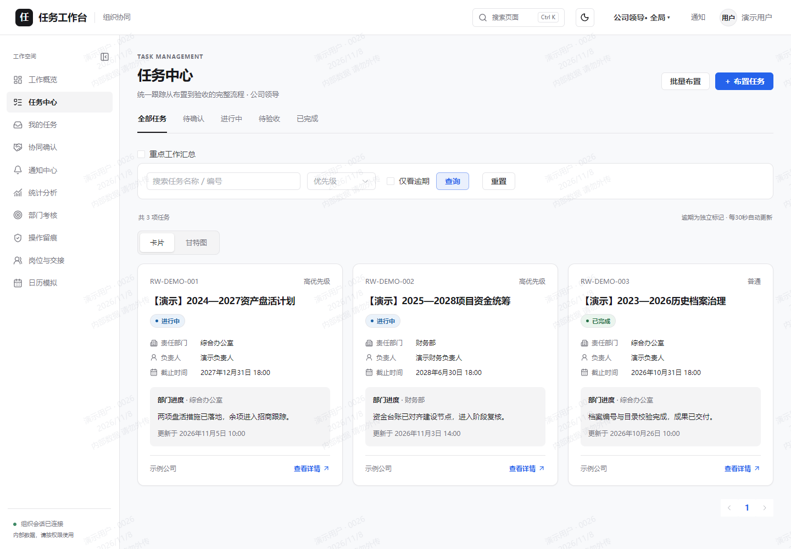
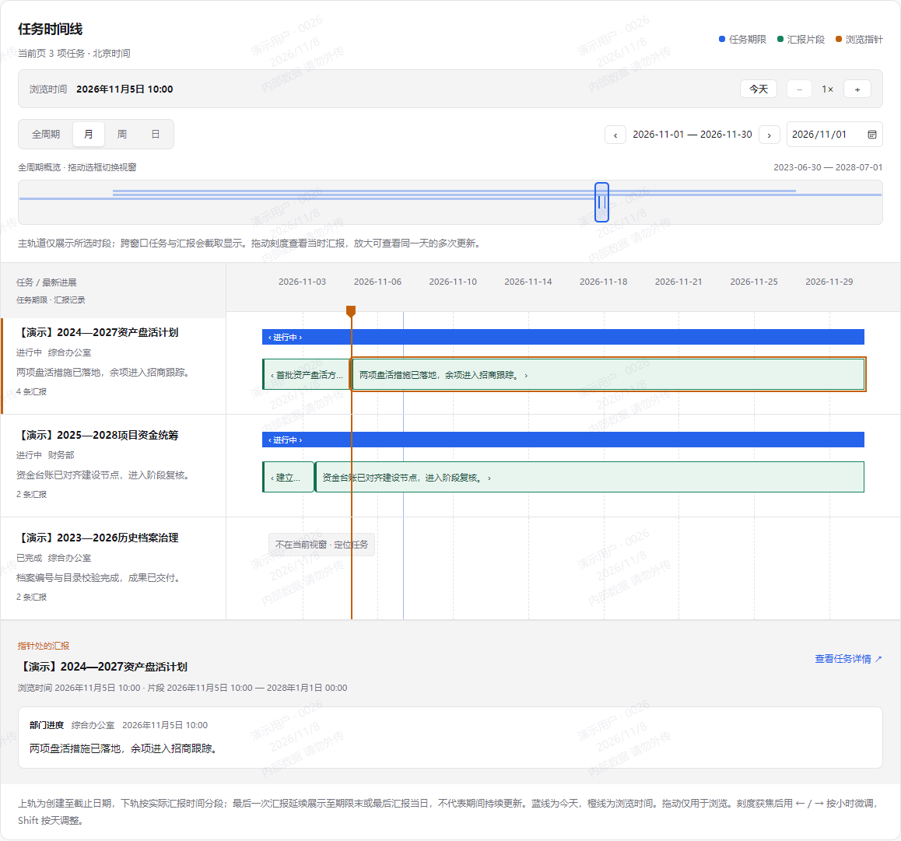
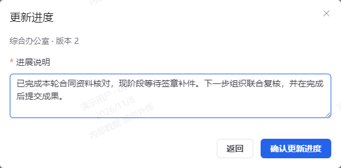
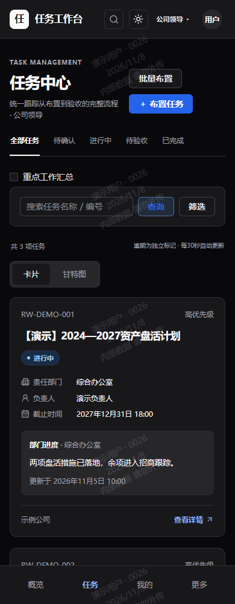

# Task Workbench V1.5

An organizational workbench for assigning tasks, coordinating departments, recording written updates and reviewing delivery—with responsibility and history in one place.

[简体中文](README.zh-CN.md) · **English** · [User guide](docs/operations/task-ui-guide.md) · [Deployment](docs/operations/deployment.md) · [Build checks](https://github.com/DreamyXiam/task-workbench/actions/workflows/verify.yml)

> **Development preview.** Suitable for source review and isolated evaluation; production acceptance remains pending. See the [acceptance matrix](docs/testing/acceptance-matrix.md) and [release checklist](docs/release/v1.5-release-checklist.md).



## What it does

| Capability | Experience |
| --- | --- |
| Assignment and ownership | Create individual or batch tasks with a host department, collaborators, owner and deadline |
| Task cards | Read the latest report and status; open details from anywhere on a card |
| Written updates and delivery | Record updates, submit results, summarize and accept through explicit workflow actions |
| Multi-year timeline | Browse report clips using a full-cycle overview and month, week or day windows |
| Independent work items | Assign smaller items to people and select In progress or Completed |
| Scoped access and audit | Apply company, department and role boundaries to actions, attachments and records |
| Collaboration and assessment | Confirm cross-company work, follow notifications and inspect auditable KPI snapshots |
| Desktop and mobile themes | Use the same workflow in light and dark layouts, including narrow screens |

Task views show **workflow status and written updates**, without per-task completion percentages or percentage progress bars. Historical numeric values remain compatible with existing interfaces. Aggregate rates and KPI metrics retain their own definitions.

## Interface preview

These images render the current frontend with synthetic API responses and fictional demonstration records. They contain no real business records or login credentials. They illustrate the interface, rather than certify live backend behavior or production acceptance.

### Multi-year tasks, readable report history

The overview retains the complete span while the main track defaults to the current month. Drag the selection, switch to a week or day, or jump to a date. Select a clip to inspect the original report; browsing does not reschedule tasks.



### Report in words, advance through explicit states

The update form asks for a written report. Submission, summarization and acceptance remain separate actions. Independent work items use an In progress / Completed selector.



### Mobile and dark theme

Cards retain status, responsibility and the latest update, with navigation and filters adapted to narrow screens.

<p align="center"></p>

## Quick start

### 1. Prepare the build environment

| Component | Requirement |
| --- | --- |
| Java | Patched Java 21 |
| Maven | 3.9 or later |
| Node.js | Node 24 LTS / npm; exact constraints in [frontend/package.json](frontend/package.json) |
| Database | MySQL 8.4 LTS deployment baseline; isolated H2 for the local demo |

From the repository root:

```powershell
mvn -B -ntp -f backend/pom.xml verify
Set-Location frontend
npm ci
npm run lint
npm run typecheck
npm test
npm run build
Set-Location ..
```

`./scripts/verify.ps1` runs the same checks. `-Offline` reuses cached dependencies without changing their versions. See [ADR-001](docs/adr/ADR-001-tech-stack.md) for the stack baseline.

### 2. Start a local demo

After installing dependencies, replace these paths with the runtimes installed on your machine:

```powershell
./scripts/start-demo.ps1 -Demo -JavaPath 'C:\your-jdk-21\bin\java.exe' -NodePath 'C:\your-node-24\node.exe' -MavenPath 'C:\your-maven\bin\mvn.cmd'
```

The launcher uses an isolated H2 database, binds to loopback and securely prompts for an initial password. Open the frontend URL it reports. Accounts must change the password on first login; leadership and administrator accounts then enroll TOTP. **No fixed password is shipped.**

Account names, ports, shutdown, Node 22 compatibility and DPAPI key handling are documented in the [local Windows demo guide](docs/operations/local-demo.md). A healthy process still requires real login and workflow validation.

### 3. Deploy a self-hosted instance

Follow [deployment and rollback](docs/operations/deployment.md) to configure Linux/systemd/Nginx, MySQL, HTTPS, external credentials and an independent key. Prepare [backup and recovery](docs/operations/backup-restore.md) and [monitoring](docs/operations/monitoring.md). `.env.example` documents configuration names; it is not automatically loaded.

## Documentation

| Audience | Start here |
| --- | --- |
| Users and administrators | [Task UI and reporting](docs/operations/task-ui-guide.md) · [User/admin guide](docs/operations/user-admin-guide.md) |
| Developers | [Development](docs/development.md) · [API notes](docs/api/contract-notes.md) · [OpenAPI](docs/api/openapi.yaml) |
| Operators | [Deployment](docs/operations/deployment.md) · [Backups](docs/operations/backup-restore.md) · [Monitoring](docs/operations/monitoring.md) |
| Evaluators | [Requirements](docs/requirements/v15-tasks.md) · [Implementation evidence](docs/implementation/) · [Release checklist](docs/release/v1.5-release-checklist.md) |
| Architecture and security | [ADR register](docs/adr/README.md) · [Security baseline](docs/security/security-baseline.md) · [Vulnerability reporting](SECURITY.md) |

The preserved business baseline is one host department, 0–2 collaborators and explicit cross-company agreement; the five original KPI weights are 30/25/20/10/15, objections last 7 days, and personal KPI is disabled by default. New formulas and policies remain simulations until approved.

## License and contributing

Original code is licensed under [GNU AGPL v3.0 only](LICENSE) (`AGPL-3.0-only`). Third-party components retain their own licenses; dependency inventories, SBOMs and distribution conditions are recorded in the [license review](docs/release/licenses/REVIEW.md). Network deployments of modified versions must provide the appropriate [corresponding source](docs/release/source-distribution.md).

Read [CONTRIBUTING](CONTRIBUTING.md) before development and use the [security reporting process](SECURITY.md) for vulnerabilities. Publication and release status follow the [open-source checklist](docs/release/open-source-readiness.md).
