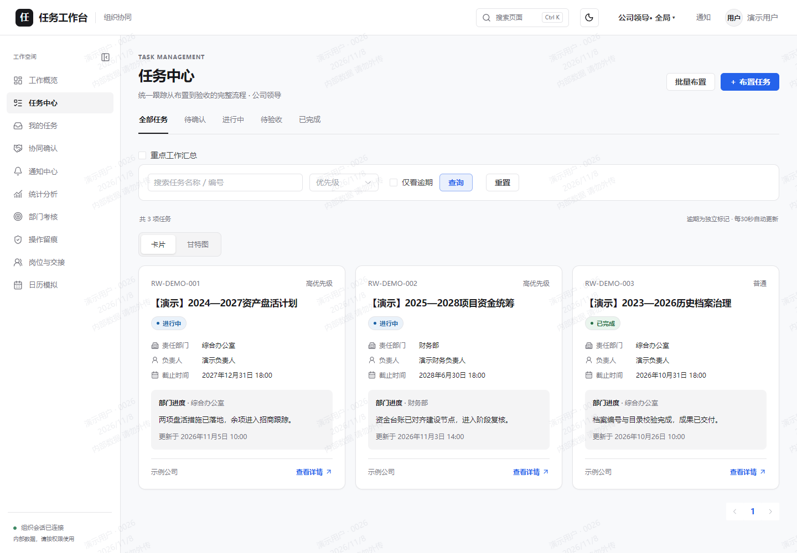
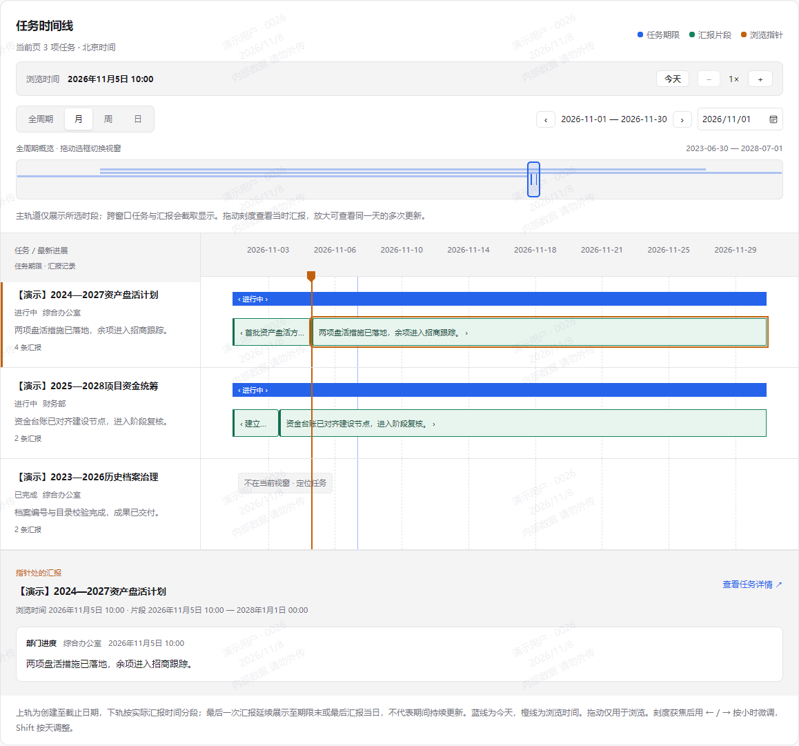
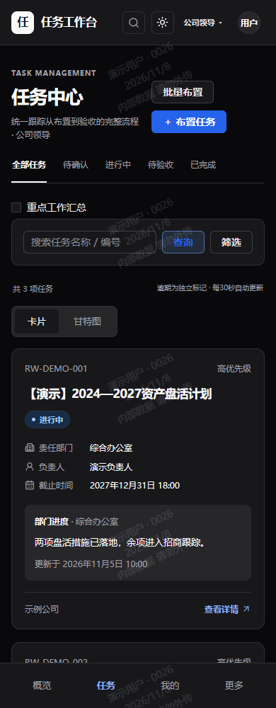

# 任务工作台 V1.5

面向组织协同的任务工作台：从任务布置、部门执行、文字汇报到成果验收，在同一个工作空间追踪责任与进展。

**简体中文** · [English](README.md) · [操作指南](docs/operations/task-ui-guide.md) · [部署文档](docs/operations/deployment.md) · [构建检查](https://github.com/DreamyXiam/task-workbench/actions/workflows/verify.yml)

> **开发预览版**：可用于源码审查和隔离环境试用，生产验收尚未完成。实际范围与待办见[验收矩阵](docs/testing/acceptance-matrix.md)和[发布清单](docs/release/v1.5-release-checklist.md)。



## 核心能力

| 能力 | 使用方式 |
| --- | --- |
| 任务布置与责任分工 | 单条或批量布置，明确主办、协办、负责人和截止时间 |
| 卡片式任务中心 | 查看状态及最新进展，点击卡片任意位置进入详情 |
| 文字汇报与成果验收 | 汇报说明留痕，通过接收、提交、汇总和验收推进状态 |
| 多年任务时间轴 | 全周期概览与月／周／日视窗，按汇报时间分段浏览 |
| 独立子任务 | 将工作拆分到具体人员，通过“进行中／已完成”更新状态 |
| 组织权限与审计 | 公司、部门、岗位范围控制，授权操作、附件与历史记录 |
| 协作与考核 | 跨公司协作确认、通知、统计及可追溯的 KPI 快照 |
| 浅色、深色与手机布局 | 同一套工作流适配桌面与窄屏 |

任务界面展示**流程状态与文字进展**，不显示单项任务进度百分比或百分比进度条。历史数值保留兼容；统计完成率和 KPI 指标按各自口径计算。

## 界面预览

以下配图由当前前端渲染，使用合成 API 与虚构演示记录，不包含真实业务数据或登录凭据。截图用于说明界面，不代表真实后端或生产验收通过。

### 多年任务：看全局，也能查看每次汇报

上方概览保留多年跨度，主轨道默认展开当前月份。拖动选框、切换周／日或跳转日期后，点击片段查看当时的汇报内容。浏览操作不会调整任务期限。



### 更新进展：填写说明，按业务流程推进状态

进展表单只填写说明；成果提交、汇总上报和验收分别保留独立操作。独立子任务可直接选择“进行中”或“已完成”。


### 手机端与深色主题

任务卡片保留状态、责任信息和最新汇报；导航与筛选适配窄屏。

<p align="center"></p>

## 快速开始

### 1. 准备构建环境

| 组件 | 要求 |
| --- | --- |
| Java | 已修补的 Java 21 |
| Maven | 3.9 或更高版本 |
| Node.js | Node 24 LTS / npm；精确要求见 [frontend/package.json](frontend/package.json) |
| 数据库 | 部署基线为 MySQL 8.4 LTS；本地演示使用独立 H2 |

在仓库根目录执行：

```powershell
mvn -B -ntp -f backend/pom.xml verify
Set-Location frontend
npm ci
npm run lint
npm run typecheck
npm test
npm run build
Set-Location ..
```

也可运行 `./scripts/verify.ps1`；`-Offline` 只复用缓存，不改变依赖版本。技术选型见 [ADR-001](docs/adr/ADR-001-tech-stack.md)。

### 2. 启动本地演示

先完成依赖安装，再将下方路径替换为本机已安装的运行时：

```powershell
./scripts/start-demo.ps1 -Demo -JavaPath 'C:\your-jdk-21\bin\java.exe' -NodePath 'C:\your-node-24\node.exe' -MavenPath 'C:\your-maven\bin\mvn.cmd'
```

启动器使用隔离的 H2 数据库，仅监听本机回环地址，并安全提示输入初始密码。按输出的前端地址访问；账号首次登录需修改密码，领导及管理员账号随后绑定 TOTP。**项目不提供固定密码。**

可用账号、端口、停止方式、Node 22 兼容范围和 DPAPI 密钥管理见 [Windows 本地演示指南](docs/operations/local-demo.zh-CN.md)。健康检查通过不等于已完成真实登录和业务验收。

### 3. 部署自托管实例

按[部署与回滚指南](docs/operations/deployment.md)配置 Linux/systemd/Nginx、MySQL、HTTPS、外部凭据及独立密钥；同时准备[备份与恢复](docs/operations/backup-restore.md)和[监控](docs/operations/monitoring.md)。`.env.example` 仅说明配置项，不会自动加载。

## 文档导航

| 读者 | 入口 |
| --- | --- |
| 使用者与管理员 | [任务界面与汇报](docs/operations/task-ui-guide.md) · [用户及管理员指南](docs/operations/user-admin-guide.md) |
| 开发者 | [开发说明](docs/development.md) · [API 契约](docs/api/contract-notes.md) · [OpenAPI](docs/api/openapi.yaml) |
| 运维人员 | [部署](docs/operations/deployment.md) · [备份](docs/operations/backup-restore.md) · [监控](docs/operations/monitoring.md) |
| 评估与验收 | [需求](docs/requirements/v15-tasks.md) · [实现记录](docs/implementation/) · [发布清单](docs/release/v1.5-release-checklist.md) |
| 架构与安全 | [ADR 登记](docs/adr/README.md) · [安全基线](docs/security/security-baseline.md) · [安全报告](SECURITY.md) |

现有业务基线：一个主办部门、0–2 个协办部门，跨公司协办须明确同意；原有五项 KPI 权重为 30/25/20/10/15，异议期为 7 天，个人 KPI 默认关闭。新公式和策略在批准前作为模拟方案。

## 开源与参与

原创代码采用 [GNU AGPL v3.0 only](LICENSE)（`AGPL-3.0-only`）。第三方组件保留各自许可证，依赖清单、SBOM 与分发条件见[许可证审查记录](docs/release/licenses/REVIEW.md)。网络部署修改版须提供与实际版本对应的[源码入口](docs/release/source-distribution.md)。

参与开发请阅读[贡献指南](CONTRIBUTING.md)；报告漏洞请使用[安全报告流程](SECURITY.md)。公开和发布状态以[开源准备清单](docs/release/open-source-readiness.md)为准。
